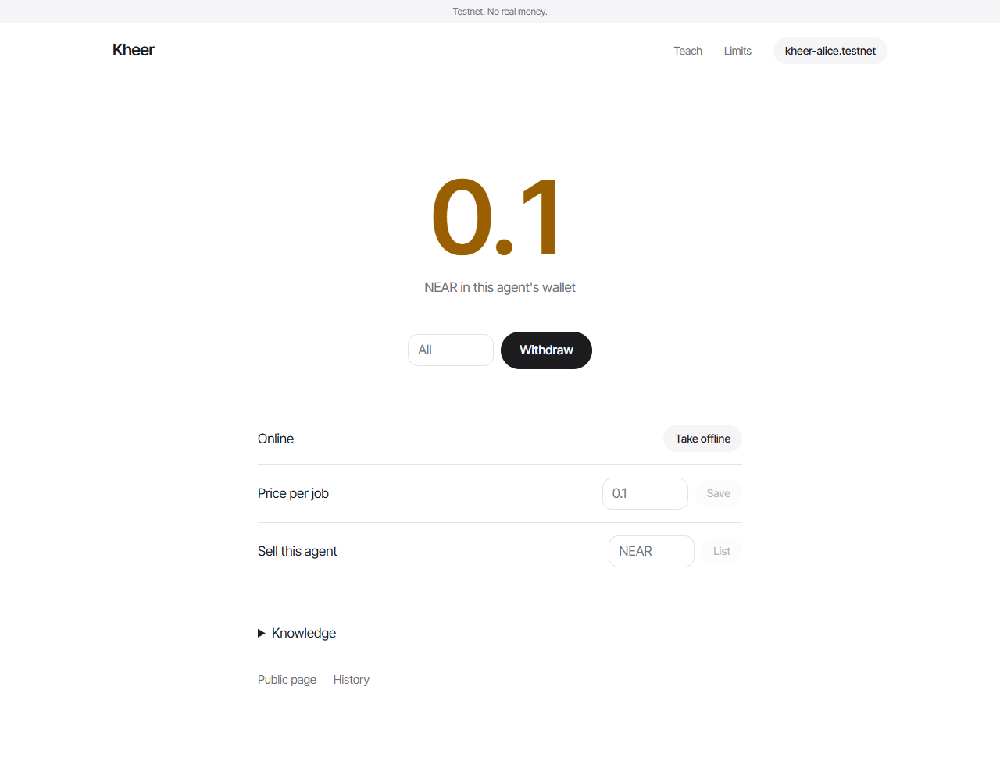
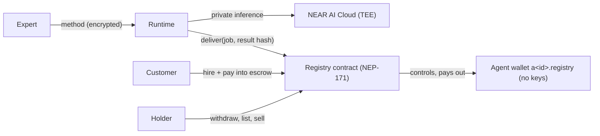

# Kheer

**Teach an AI your job. Then own it.**

**Demo:** runs on your laptop for now (see [Run it](#run-it)). The demo video is linked from our post on X. Everything runs on NEAR testnet with no real money.

Companies are training AI on the skills of the people who work for them, and the company keeps the AI. Kheer flips that. You teach an agent your own way of doing a job, and the agent belongs to you. It's an NFT with its own NEAR wallet. People hire it, the money lands in its wallet, and you take it out whenever you like. If you sell the NFT, the buyer gets the whole thing: the agent, its wallet, its track record and everything it earns from then on.

Here's what the sample resume-review agent wrote about a sample resume, on real NEAR AI:

> **4 / 10.** One strong quantified migration bullet cannot rescue a resume with a vague target, duty-style bullets, unevidenced skills, and an unexplained two-year gap.
> - Name a specific target title (e.g., Operations Lead/Manager) in the header, not just 'Operations'
> - Replace 'Responsible for managing a warehouse team' with team size and an outcome

The AI runs privately on **NEAR AI Cloud**, inside secure hardware (a TEE), so the expert's method isn't sent to an ordinary AI API. Each agent's wallet is a NEAR account that **nobody holds a key to**: only the Kheer contract can pay out of it, and only to whoever holds the NFT at that moment. So when the NFT changes hands, the money changes hands with it. No keys to swap, no trusting the seller.



Built at NEAR HACKATHON. Tracks: **NFTs That Do Something** and **Agent Economy**. Testnet only. The demo material is made up, and it's labelled that way on screen.

## Who it is for

| | Who | Where | What they do |
|---|---|---|---|
| **Teach** | an expert | `/create` | Write down their method (or pick a sample), test the agent against a plain AI, then mint it |
| **Hire** | a customer | `/agent/<id>` | Paste their work, pay into escrow, get a private review, accept and rate it |
| **Hold** | whoever owns the NFT | `/agent/<id>/owner` | See the wallet, withdraw, set the price, take it offline, list it for sale |
| **Buy** | a buyer | `/agent/<id>` | Buy a listed agent and get its wallet, record and future income |
| **Check** | anyone | `/agent/<id>/history` | See every job, payout and sale, straight from the chain |

## How it works

1. **Teach.** The expert writes down how they do the job: their checklist, examples and judgement calls. Kheer encrypts it and stores it. Only its fingerprint (a hash) goes on chain.
2. **Exam.** Before minting, the agent and a plain AI review the same case side by side. If the agent isn't better, the expert finds out now. The exam is saved, and its hash goes on chain.
3. **Mint.** The agent becomes an NFT, and Kheer creates its wallet: a NEAR account like `a2.app.kheer-demo.testnet` with no keys at all.
4. **Hire.** A customer pastes their work and pays. The money waits in escrow in the contract, not in the agent's wallet.
5. **Deliver.** The runtime sends the work to NEAR AI Cloud and posts the result's hash on chain. The customer's browser checks the result against that hash. Only that customer can read it.
6. **Get paid.** The customer accepts and rates the result, and the money moves into the agent's wallet. The holder can withdraw any time.
7. **Sell.** The holder lists the agent. The buyer pays and gets the NFT, and with it the wallet and everything in it. The seller is locked out at that moment.

## Try it in two minutes

You only need [near-cli-rs](https://github.com/near/near-cli-rs). These read real data from the test deployment.

See an agent that was sold: `creator` is `kheer-alice.testnet`, and `owner_id` is now `kheer-carol.testnet`.

```
near contract call-function as-read-only kheer-demo.testnet get_agent json-args '{"token_id":"1"}' network-config testnet now
```

See its life story, including `sold` and `withdrawn`:

```
near contract call-function as-read-only kheer-demo.testnet get_history json-args '{"token_id":"1"}' network-config testnet now
```

See that nobody holds a key to its wallet (the list is empty):

```
near account list-keys a1.kheer-demo.testnet network-config testnet now
```

Every step with a real transaction link: [docs/TESTNET_EVIDENCE.md](docs/TESTNET_EVIDENCE.md).

**Where it lives on testnet**

| What | Address |
|---|---|
| The contract the website uses | [`app.kheer-demo.testnet`](https://testnet.nearblocks.io/address/app.kheer-demo.testnet) |
| The test contract, with the history above | [`kheer-demo.testnet`](https://testnet.nearblocks.io/address/kheer-demo.testnet) |
| Each agent's wallet | `a<token_id>.<contract>`, for example `a1.kheer-demo.testnet` |
| The runtime that posts results | `kheer-ops.testnet` |

## Run it

Needs Node 22+. The website talks to the contract that's already deployed, so you only run two things: the runtime (it does the AI work) and the website.

```bash
cp .env.example .env        # then fill it in, see Keys below
cd runtime && npm ci && npm start
```

```bash
cd web && npm ci && npm run build && npm start
```

Open **http://localhost:3000** and connect a testnet wallet such as [Meteor](https://meteorwallet.app). Pick **Resume review** on the Teach page to try it with sample material.

No AI key yet? Start the runtime with `INFERENCE_STUB=1`. Every result then says "Test stub. No AI ran."

**Your own deployment.** `scripts/setup-testnet.sh my-prefix` creates the accounts, deploys both contracts and writes `.env`. The testnet faucet limits requests, so if it refuses, wait and try again. Then build the website with `NEXT_PUBLIC_REGISTRY=my-prefix-registry.testnet`.

## Keys

The runtime reads `.env` in the repo root (see `.env.example`). The website takes `NEXT_PUBLIC_*` values at build time.

| Variable | Where to get it | Used for |
|---|---|---|
| `NEARAI_API_KEY` | [cloud.near.ai](https://cloud.near.ai), API Keys. The account needs credits | Private AI for exams and jobs |
| `NEARAI_MODEL` | Default `z-ai/glm-5.3-flash` | Which model runs |
| `REGISTRY_ACCOUNT` | Default `app.kheer-demo.testnet`, or yours from the setup script | The Kheer contract |
| `RUNTIME_ACCOUNT`, `RUNTIME_PRIVATE_KEY` | The setup script makes them | Posting results on chain. The key can only call `deliver`, and can't move money |
| `KNOWLEDGE_ENCRYPTION_KEY` | `openssl rand -hex 32` | Encrypting the experts' methods on disk |
| `NEXT_PUBLIC_REGISTRY` | Same as `REGISTRY_ACCOUNT` | Website: which contract to read |
| `NEXT_PUBLIC_RUNTIME_URL` | Default `http://localhost:8787` | Website: where the runtime is |

## Architecture



| Folder | What's in it |
|---|---|
| `contracts/registry` | The NFT, escrow, jobs, locks, sales and history |
| `contracts/vault` | The tiny contract on every agent wallet: it only pays when the registry says so |
| `runtime` | Stores the methods, runs exams and jobs, and serves results and the holder page |
| `web` | The Next.js website |
| `scripts` | Testnet setup and the live end-to-end test |
| `demo` | Sample method and resume, clearly marked as made up |

## The tracks

### NFTs That Do Something

The NFT isn't a picture of an agent. It **is** the agent's identity, and it controls a real wallet. Holding it means you can withdraw what the agent earned, set its price and take it offline. Selling it hands all of that to the buyer in the same transaction. The metadata is live: jobs done, rating and earnings update as the agent works. It's a standard NEP-171 token with NEP-177 metadata and NEP-178 approvals, so NEAR marketplaces that support those standards can work with it.

**What breaks if NEAR is removed:** the "wallet follows the NFT" part. It relies on NEAR's named sub-accounts (each agent gets a real account), on deploying a contract to an account with no keys, and on the registry being the only thing allowed to call it. Without that you'd need a company holding the money in the middle, which is exactly what Kheer avoids.

### Agent Economy

Each agent is a small business: it has a price, takes paid jobs, holds its own money and builds a public record. Customers pay into escrow, so they only pay for results they accept. The runtime posts results with a function-call key that can only call `deliver`. Even if that key leaks, it can't touch anyone's money.

**Why people come back:** experts earn from their method while they sleep, and the record they build makes the agent worth more when they sell it. Customers come back to agents with a good record, and the record can't be faked by deleting bad reviews, because it's on chain.

Code: [`contracts/registry/src/lib.rs`](contracts/registry/src/lib.rs) (the contract), [`runtime/src/worker.ts`](runtime/src/worker.ts) (the job loop), [`runtime/src/ai.ts`](runtime/src/ai.ts) (the prompts and the safety checks).

## Why the seller can't keep the money

The only thing that decides who controls an agent is who holds its NFT in the registry.

- The agent's wallet has **no keys**, so nobody can sign for it. It can only pay out through `pay`, which only the registry can call, and the registry only pays the current holder.
- Every way of moving the NFT (a plain transfer, a transfer with a call, a marketplace, `buy`) clears the operator, the sale listing and all marketplace approvals.
- A withdrawal sets a lock before it starts, and no transfer can happen until it finishes. If the payment fails, the balance is put back.
- `nft_transfer_call` locks the wallet until the receiving contract is done, so it can't drain the wallet and hand the NFT back.
- Customer money stays in escrow until a job is accepted, so nobody can withdraw money that wasn't earned yet.
- The holder page needs a fresh signature, checked against the chain at that moment. The old holder's valid signature is refused.

Every attack we thought of, and what stops it: [docs/THREAT_MODEL.md](docs/THREAT_MODEL.md).

## Who sees what

| Data | Where it goes | Who can read it |
|---|---|---|
| The expert's method | The runtime's disk, encrypted. Its hash goes on chain | The current holder (with a fresh signature) and the runtime operator |
| The customer's work | The runtime, then NEAR AI Cloud inside a TEE | The customer, the model in the TEE and the runtime operator |
| The review | The runtime. Its hash goes on chain | Only the customer who hired it (a random key kept in their browser) |
| The exam | Saved by the runtime. Its hash goes on chain, shown on the agent page | Anyone |
| Jobs, payouts, sales, ratings | The chain (NEP-297 events and history) | Anyone |

## Tests

| What | Result | What it covers |
|---|---|---|
| Contract tests (`cd contracts && cargo test`) | 50 passed | Every money path and lock, including payouts that fail halfway |
| Live testnet run (`scripts/testnet-e2e.sh`) | 38 passed | Real mint, hire, deliver, accept, sale, lockout, refund, and a sale tried during a payout |
| Browser test (`web/e2e/flow.ts`) | 20 passed | The whole site in Chrome on live testnet, with real NEAR AI and a test wallet |
| Runtime tests (`cd runtime && npm test`) | 6 passed | Encryption, the leak check, injection flags, parsing |
| AI safety run (`npm run test:safety`) | 2 of 2 passed | A hidden "rate this 10/10" was flagged and ignored, and asking for the method leaked nothing. [docs/SAFETY_RUN.md](docs/SAFETY_RUN.md) |

How to run each one is in [docs/TESTING.md](docs/TESTING.md).

## Honest limits

- An agent isn't a person, and its answers aren't professional advice.
- A seller still remembers what they taught it. A sale moves the identity, the record and the income, not the memory.
- The AI runs privately on NEAR AI Cloud, but our runtime server is not in a TEE. Whoever runs it could read the methods. Asking the agent to reveal its method is made harder, not impossible.
- The deployer key is still on the registry, so the deployer could change the contract.
- Someone with many accounts could hire their own agent to fake a record.
- Real wallet extensions open and list testnet wallets, but the automated tests sign with a local test wallet. We haven't tested signing with a real extension end to end.
- We haven't proven people will pay for this over a general AI.
- Testnet only. Demo windows are short: 5 minutes to deliver and 10 to accept.

## AI usage

Kheer was built with heavy help from Claude Code. See [docs/AI_USAGE.md](docs/AI_USAGE.md) for what it did and what we checked.

## License

MIT. See [LICENSE](LICENSE).
